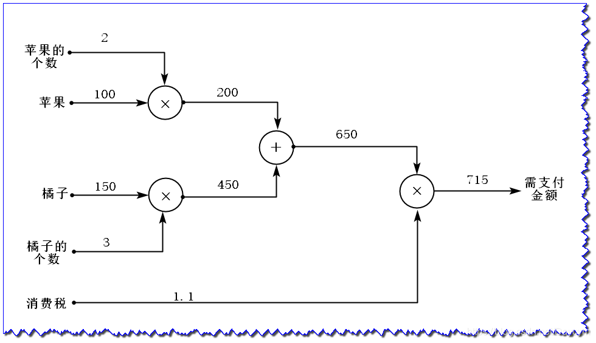

# part 1核心概念理解
## 1.1什么是梯度
* 数学定义：∇f(x,y)=( ∂f/∂x, ∂f/∂y ), 偏导数公朴成的向量
* 几何意义：梯度的方向是函数值增长最快的方向，梯度的模表示最大变化率
* 在机器学习中，梯度和损失函数有关，模型通过计算每个点处的梯度来调整参数，以便让损失函数最小化，达到最优点

## 1.2什么是梯度下降
* 基本思想：沿着损失函数梯度的反方向更新参数逐步逼近局部或者全局最优点
* 学习率：参数更新的步长，位于0与1之间，过大则参数变化太快，直接跳过最优点进入震荡，过大的话收敛太慢，耗时极长，并且容易陷入局部的最优点
* 变体：动量法（momentum）加入“惯性”，累计历史的梯度，加速收敛； Adam，加入惯性的同时自适应学习率。

## 1.3什么是反向传播
* 解决什么问题：深层网络参数数量极其庞大，梯度的计算量太大
* 计算过程：前向传播、反向传播、更新参数   
例：假设我们有如下需求：

一个苹果100块钱，一个橘子150块钱。消费税为10%  
买了2个苹果，3个橘子，一共需要支付多少钱？  
  
从左向右为前向传播：通过训练数据和权重参数计算输出结果    
从右向左为反向传播：通过导数链式求导法则计算损失函数对各参数的梯度，并根据梯度更新参数

* 关系：反向传播算法本质上是微积分中链式法则在计算图上的高效算法实现。反向传播正是沿着计算图，将这种局部的导数逐层相乘（连乘），从而求得最终输出对底层输入（或参数）的导数。

## 1.4什么是损失函数
* 作用：用来衡量预测值与真实值之间的误差，作为模型优化的目标函数
* 常见函数：  
均方误差：计算差值平方和的均值，通常用于回归任务  
交叉熵误差：衡量两个概略分布之间的差异，用于分类任务  
平均绝对误差：计算差值绝对值的均值，用于回归任务
* 使用什么损失函数:均方误差  
为什么：MSE为凸函数，只有全局最小值，没有局部最小值，适用于梯度下降；平方项对大误差铭感，会促使模型惩罚大误差；概率推导

## 1.5线性回归的数学表达
* L(w,b)= 1/2n∑(wx_i+b-y_i)^2(从1到n累加)，为了方便求导乘了1/2
* ∂L/∂w=1/n∑(wx_i+b-y_i)x_i(直接求导后，平方求导的2与分母消掉，内层求导得到系数x_i)  
∂L/∂b=1/n∑(wx_i+b-y_i)(同理)
* 参数更新公式  
w=w-α*∂L/∂w  
b=b-α*∂L/∂b  
注：简答题答案为综合AI、知乎、CSDN以及本人大一看吴恩达视频与薄弱微积分知识得出

# part3选做题
* 不能很好拟合，线性回归中输入与输出之间是线性关系，但是题目中明显不是。方法：使用非线性的激活函数；构造多项式回归去拟合
* 在我的两道题目中确实是单调递减，但在实际项目中是不一定单调递减的。可能是因为学习率过大；数据本身有明显噪声或者异常值；使用动量导致“走的太远”；陷入局部最小值