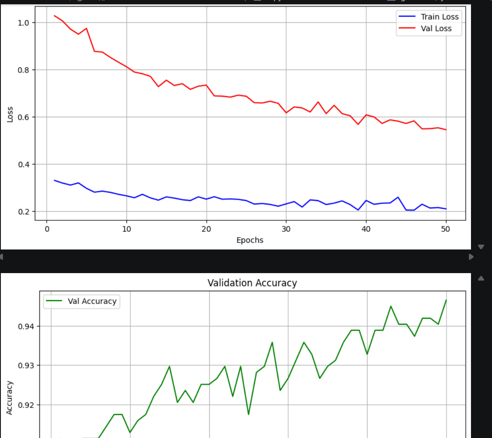
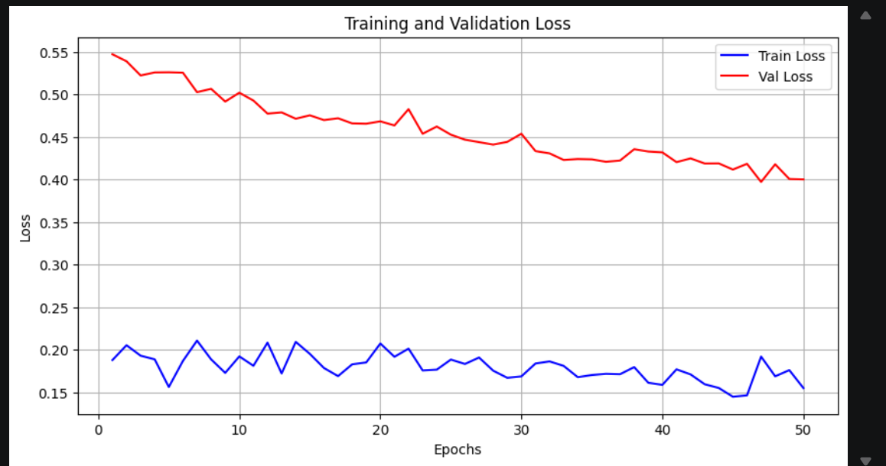
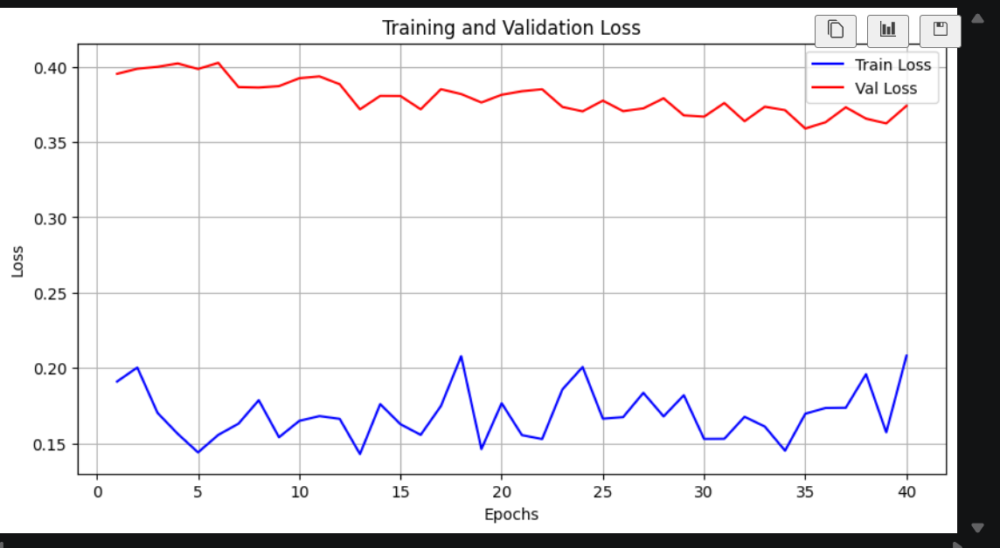

# part1
## 1.1类别特征编码
* 独热编码：把每一个类别特征都转换为一个独立的二进制列
注：类别特征即为离散型的特征，也有连续特征如身高  
例子：某个特征有三个类别（红 黄 蓝）  
      红：[1, 0 ,0]  
      绿：[0, 1 ,0]  
      蓝：[0, 0 ,1]  
      第一列表示是不是红色，后面两列同理
* 标签编码：给每个类别分配一个唯一对应的整数。  
区别：标签编码有大小关系，而独热编码中每一个维度是平等的
* 哪种编码方式更常用：独热编码。当使用标签编码时，神经网络内部的乘法和加法运算会由于数值大小不一样导致梯度被错误地放大，对应数字大地类别被过度更新，数字小地类别则被忽略
## 1.2数据标准化
* C产生的梯度非常大，对应的权重被疯狂地调整，如果使用sigmoid这种函数则梯度极快饱和，梯度变成0，而a的权重此时保持几乎不变
* 当特征尺度差异过大时，梯度等高线的形状为一个非常细长的椭圆，此时的梯度方向几乎垂直于这个椭圆的长轴，梯度下降时在这个方向来回震荡
* Z-Score 标准化：将数据缩放为均值为0，标准差为1的分布（不是变成正态分布，不改变原本的分布形状）。  
  x′=（x-μ）/σ（μ是均值，σ是标准差）
  Min-Max 归一化：将数据线性地映射到[0，1]的区间内
  x′=(x-min(x))/(max(x)-min(x))
* 使用训练集得到的scaler，不能重新fit一次。因为测试集对于模型时未知的数据，对测试集进行fit意味着将测试集信息泄露给了模型，并且会导致，训练集和测试集的缩放标准不一致。  
注：fit：拟合；fit时StandardScaler会记录这批数据的平均值与标准差
## 1.3训练/验证/测试
* 训练集：用于训练模型、更新参数
  验证集：用来调参（如选择学习率、网络层数，和更新参数不同，不是自动完成而是人为选择）和早停，发现模型是否有过拟合的问题  
  测试集：评估模型在真实情况的泛化能力
* 不能拿测试集调参：用测试集来调参，模型会记住测试集的特征，导致数据泄露，最后测试效果会偏高
  用训练集做验证：无法判断模型是否过拟合，并调整成合适的超参数，因为模型既是过拟合也会在训练集上表现极好
* 从原始数据集中划分随机一定比例的的数据作为验证集；  
  如果数据量较小，使用 K折交叉验证 (K-Fold Cross Validation)，将数据分成 K 份，每次拿 1 份做验证，其余 K-1 份做训练，重复 K 次取平均，充分利用所有数据。
## 1.4分类任务的评估
* 准确率在类别不均衡时：失去参考价值  
  例子；进行疾病诊断时，一百个数据中，99个为健康，此时如果无论输入什么模型都预测健康，此时的准确率依然达到99%，但是却根本没有判断出唯一一个需要治疗的病人，而这反而是重点。
* 精确率：预测为正的样本中，真正为正的比例。衡量对正类预测的准确度与可信度。  P=TP/(TP+FP)
  召回率：真正为正类的所有样本中，被模型成功预测为正类的比例。衡量漏报的程度.  R=TP/(TP+FN)
  F1-Score:精确率和召回率的调和平均数。当两者发生冲突时，用来综合评价模型。  F1=2*P*R/(P+R)
* 混淆矩阵：  
  TP（真正例）：预测为1，实际为1
  TN（真负例）：预测为0，实际为0
  FP（假正例）：预测为1，实际为0
  FN（假负例）：预测为0，实际为1
* ROC曲线:以假正率为横轴，真正率为纵轴画出的曲线，衡量模型在不同的分类阈值下的综合表现  
  AUC：ROC曲线下方的面积。代表随机挑选一个正样本和一个负样本，模型给正样本打分高于负样本的概率（排序能力）
## 1.5小批量训练
* Batch GD (全量)：每次都要更新全部数据的参数，计算很慢，占用内存太多；同时因为过度精确容易陷入局部最优  
  SGD：每次只用一个样本，计算出的梯度没什么代表性，方差太大，会不停地剧烈震荡；不能利用GPU的并行加速能力  
  Mini-Batch：既能利用GPU的并行加速能力，又能提供相对稳定地梯度，同时保留轻微的震荡
* batch_size：控制每次喂给模型的数据量，也就是批次大小，一般使用32或64  
  shuffle：决定在每个epoch前是否打乱数据顺序
  训练集时必须设为true，防止模型学习数据的顺序特征  
  验证集时设为false，模型不会学习验证集的特征，固定顺序便于复现

  # 心脏病预测 (Heart Disease Prediction) 实验报告

## 1. 数据探索
本实验使用的数据集包含 818 条训练记录和 100 条测试记录，共 11 个特征（包括年龄、性别、血压、胆固醇等），目标变量为是否患有心脏病（0 为正常，1 为心脏病）。
*   **样本分布与类别平衡**：数据集中正负样本比例基本均衡。为了防止划分验证集时导致某一类样本比例失衡，在划分训练集和验证集时使用了分层抽样（`stratify=y`）。
*   **特征统计**：数据包含了数值型特征（如 `Age`, `RestingBP`, `Cholesterol` 等）和类别型特征（如 `Sex`, `ChestPainType`, `ST_Slope` 等）。通过观察，数据整体质量较好，无明显缺失值。

## 2. 预处理方案
为了保证模型训练的稳定性和收敛速度，对数据进行了以下预处理：
*   **划分数据集**：将原始训练集按 8:2 划分为训练集（约 80%）和验证集（20%）。
*   **类别特征编码**：针对 6 个类别特征，使用 `OneHotEncoder(sparse=False, drop='first')` 进行独热编码。`drop='first'` 用于去除冗余列，防止多重共线性问题；`sparse=False` 确保输出稠密矩阵，以适配 PyTorch 的 Tensor 格式。
*   **数值特征标准化**：针对 5 个数值特征，使用 `StandardScaler` 进行标准化处理（均值为0，方差为1），消除不同量纲对模型梯度的不良影响。
*   **防数据泄露**：严格遵循“在训练集上 `fit`，在验证集/测试集上仅 `transform`”的原则，确保验证集信息不会泄露到训练过程中。

## 3. 模型结构
本实验使用 PyTorch 搭建了一个多层感知机（MLP）进行二分类预测。
*   **网络层数与神经元**：输入层维度为 15（经过预处理后的特征数），包含 2 个隐藏层，神经元个数分别为 64 和 32；输出层为 1 个神经元。
*   **损失函数**：采用 `BCEWithLogitsLoss`，该函数内置了 Sigmoid 操作，使得数值计算比先做 Sigmoid 再算 BCE 更加稳定。
*   **正则化手段与设计理由**：
    *   `BatchNorm1d`：在隐藏层后加入批归一化，有效加速网络收敛，缓解梯度消失。
    *   `Dropout(0.3)`：考虑到数据集样本量较小，网络极易过拟合，因此在每个隐藏层后加入丢弃率为 0.3 的 Dropout，随机失活部分神经元，强迫模型学习更加鲁棒的特征。

## 4. 训练过程
*   **初始超参数设置**：初始学习率 `lr=0.01`，训练轮数 `epochs=50`，优化器采用 `Adam`，批次大小 `batch_size=32`。
*   **初始训练现象**：
    *   从初始训练曲线可以看出，验证集 Loss 在后期下降缓慢，且与训练集 Loss 差距较大；准确率曲线震荡极其剧烈（最终在 94% 左右），这说明模型存在一定程度的过拟合，且学习率偏大导致优化过程在最优解附近来回震荡。

## 5. 改进策略
针对初始训练中出现的“曲线震荡”和“轻微过拟合”问题，进行了以下两步改进：

*   **策略一：降低学习率（lr: 0.01 -> 0.001）**
    *   **效果**：将学习率下调后，模型参数更新的“步子”变小了。从新的曲线可以看出，Loss 曲线变得更加平滑且稳定下降，准确率曲线稳步攀升，表现出了更好的稳定性。

*   **策略二：引入早停机制（Epochs: 50 -> 40）**
    *   **效果**：观察降低学习率后的曲线发现，在 35-40 轮之后，验证集 Loss 不再明显下降，甚至有轻微抬头的趋势。为了避免多余的训练带来过拟合风险，将 epoch 缩减至 40 轮。从最终的验证集混淆矩阵来看，模型对心脏病患者的漏诊率极低，证明模型在充分收敛的同时，具备了优秀的泛化能力。

## 6. 收获与反思
在这次深度学习实践中，我完整走通了从数据预处理、模型搭建、训练调参到结果可视化的全流程，收获颇丰：
1.  **深刻体会了数据预处理的重要性**：在编写代码时，我遇到了 `OneHotEncoder` 不同版本 API 差异的问题，以及数值标准化必须在训练集上 `fit` 的规定，这些细节直接关系到模型能否跑通以及评估结果的真实性。
2.  **掌握了 PyTorch 的训练循环范式**：手写了包含 `model.train()` 和 `model.eval()` 模式切换的训练循环，深刻理解了前向传播、计算损失、反向传播、梯度清零、参数更新等核心步骤。
3.  **学会了通过可视化图表指导调参**：一开始我使用 0.01 的学习率，发现损失曲线剧烈震荡；通过对比分析，主动将学习率调整为 0.001，并配合早停（减少 Epoch），最终使得模型准确率提升并稳定在 96% 左右。这让我明白，**调参不能盲猜，要依据 Loss 和 Accuracy 的曲线趋势进行科学分析**。
4.  **测试集格式对齐的踩坑**：在生成预测结果时，我最初忽略了提交文件必须与 `example_submission.csv` 的 `id` 顺序完全一致这一要求。通过排查数据索引，最终成功输出了符合规范的 `my_submission.csv`，锻炼了我定位和解决数据格式问题的能力。

  
 